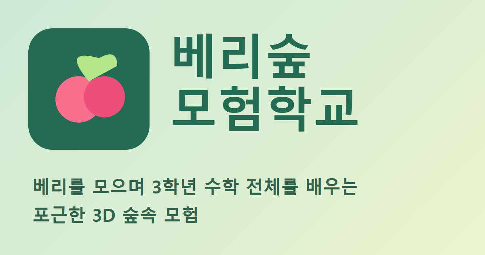
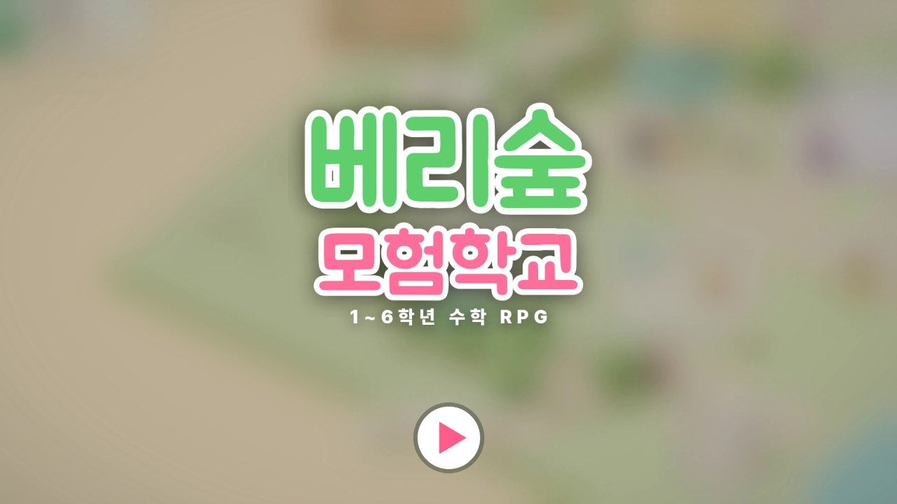

# 베리숲 모험학교

> **작은 모험, 자라는 생각.**
> 초등학교 1~6학년 수학을 숲 탐험으로 배우는 3D 학습 RPG입니다.

[](https://yangyeontae-blip.github.io/math/)

| 플레이 | 5분 홍보 영상 |
| --- | --- |
| [🎮 GitHub Pages에서 시작](https://yangyeontae-blip.github.io/math/) | [▶ 영상 바로 보기](https://yangyeontae-blip.github.io/math/promo.mp4) |
| [🌲 보조 주소에서 시작](https://berry-forest-school.yangyeontae.chatgpt.site/) | [영상 파일 열기](./public/promo.mp4) |

## 5분 안에 둘러보기

[](https://yangyeontae-blip.github.io/math/promo.mp4)

이미지를 누르면 약 **5분 길이의 홍보 영상**이 열립니다. 숲 탐험, 수학 대련, 베리 상점과 꾸미기, 학년별 수학 임무, 학습 리포트를 순서대로 볼 수 있습니다. 최신 영상 원본은 [`public/promo.mp4`](./public/promo.mp4)에 포함되어 GitHub Pages에서도 재생됩니다.

## 정리된 마을과 모험 동선

**지도와 수첩**에서 **숲으로 모험 / 나의 집 / 상점 거리** 세 목적지를 고릅니다. 화면에는 현재 목표 하나와 가까운 상호작용 대상의 이름만 표시됩니다. 첫 시작은 숲의 빛씨앗 활동 → 무료 꽃밭·벤치 제작과 배치 → 주민 방문으로 안내하며 자유 탐험도 선택할 수 있습니다.

- 운영자 공지는 모든 마을 광장 입구의 **운영자 소식**에서 읽습니다. 단계 선택과 분리되어 있으며 지도 메뉴에서도 바로 열 수 있습니다.
- **신비의 시합장**은 중앙 광장 분수 오른쪽에 있습니다. 신비 가까이에서 PC의 `E` 또는 휴대폰 대화 버튼을 누르면 다섯 번의 시합을 시작할 수 있습니다. 입구 표지판은 큰 둥근 글씨로 표시하며 카메라를 향해 읽기 쉽게 유지합니다.
- 독립 우체통 대신 **숲으로 모험 → 이야기 의뢰**에서 기존 세 이야기를 시작하거나 마칩니다. 기존 완료·진행 기록과 선물을 보존합니다.
- **나의 집**에서 방·정원·주민을 고릅니다. 기존 꽃밭·산책길·나눔 식탁은 개인 정원 남쪽 공간으로 옮겼고, 집 안에서 나오면 개인 정원으로 돌아옵니다.
- 정원 남쪽 길 끝의 **마을로 돌아가기** 문 앞에서 PC의 **E** 또는 휴대폰 **나가기** 버튼을 누르면 중앙 광장으로 돌아갑니다. 산책길 활동은 문 옆으로 떨어뜨려 배치했습니다. 방 꾸미기는 보유 가구를 고른 뒤 배치판의 원하는 칸을 누르며, 보관은 별도 버튼으로 합니다. 정원 물건은 첫 무료 제작을 자동으로 준비하고, 추가 유료 제작은 가격을 확인한 뒤 선택합니다.
- 강아지 단추와 마을 주민이 정원을 방문합니다. 56개 대사 중 실제로 놓인 꽃·시설·가구에 맞는 반응을 보여 주며 같은 말을 바로 반복하지 않습니다. 상점거리 간판은 지붕 위에 무기·의상·펫·라이딩·미용·물약을 크게 표시합니다.
- 꾸미기는 기본적으로 지금 제작할 수 있는 물건만 보여 줍니다. 전체 목록과 종류별 필터도 사용할 수 있습니다.
- 일일 미션·도감·학습 기록·대련·별빛 재탐험은 **모험 수첩**에 모았습니다. 학습 리포트는 보호자·교사 메뉴에서도 엽니다.
- 기존 저장 키와 v21 필드 구조·위치 범위를 그대로 유지합니다. 공동 정원에서 종료하면 활동 기록은 보존하고 다음 접속 시 개인 정원 입구에서 이어갑니다. 기존 제작물·재화·보상 규칙은 바꾸지 않습니다.

## 어떤 게임인가요?

### 세 곳으로 쉽게 찾아가기

- **숲으로 모험 / 나의 집 / 상점거리**에서 원하는 곳을 고릅니다. 섬 전체 지도는 필요할 때 펼칠 수 있습니다.
- **나의 집**에는 방·정원·주민이 있습니다. 정원 안에서 꾸미기, 정원 만들기 놀이, 목장과 화단을 고릅니다.
- **가방**에는 보유한 물건만 표시됩니다. 탈것 구매는 라이딩 상점에서 하며, 가방에서는 타거나 내릴 수 있습니다.
- **모험 수첩**의 발견·추억 / 친구·아이템 / 학습 기록 탭에서 기록과 복습을 확인합니다. 오늘의 미션과 보상은 **오늘의 모험**에 모았습니다.
- **하던 모험 계속하기**를 누르면 진행 중인 편지·원정·정원 활동이나 숲의 다음 목표로 이어집니다. 메뉴의 **이전 메뉴**는 들어온 화면으로, **게임으로 돌아가기**는 플레이 화면으로 돌아갑니다.
- 시합 연습 방식은 시합장에서 선택합니다. 저장 키와 저장 형식은 이번 화면 정리로 변경하지 않습니다.

베리숲 모험학교는 문제를 많이 푸는 것만을 목표로 하지 않습니다. 아이가 자기 학년에 맞는 수학 지역을 고르고, **짧은 모험 → 그림·이야기 문제 → 힌트 → 다시 도전 → 학습 기록 확인**의 흐름으로 개념을 만나도록 설계했습니다. 오답이나 대련을 멈춘 일로 베리·장비·진도가 깎이지 않으므로, 틀린 이유를 살피고 다시 시도할 수 있습니다.

- 시작할 때 1~6학년, 캐릭터, 별명을 선택합니다.
- 각 학년의 1·2학기 수학 지역은 10단계씩 차근차근 열립니다.
- 계산식만 반복하지 않고 그림, 조작 활동, 이야기 상황, 선택형·입력형 문제를 함께 사용합니다.
- 문제 그림과 단계별 힌트, 문제 읽어주기 기능으로 혼자 풀기 어려운 순간을 돕습니다.
- 모험에서 얻는 베리는 장비·의상·라이딩·펫·방 꾸미기에 사용합니다.
- 마을 우체통에서 **숲속 편지 대모험** 3편을 시작해 단서를 찾고 학년별 문제를 풀며 방 장식을 모을 수 있습니다.

## 수학 모험 지도

2022 개정 교육과정의 학년별 흐름을 바탕으로 수와 연산, 도형과 측정, 변화와 관계, 자료와 가능성 영역을 게임 안의 모험으로 바꾸었습니다. 저학년은 수 감각·모양·기초 연산에서 출발하고, 고학년은 분수·소수의 계산, 비와 비율, 원과 자료 해석까지 확장합니다.

| 게임 안의 장소 | 학습 경험 |
| --- | --- |
| 덧셈·뺄셈·곱셈·나눗셈 숲 | 학년별 계산 범위와 쉬움·보통·어려움 연습 |
| 수학 모험 지도 | 1·2학기 단원별 10단계 미션과 그림·활동 문제 |
| 그림자 몬스터 | 다시 볼 개념을 모아 복습 문제로 재도전 |
| 졸업 모험·별빛 재탐험 | 여러 단원을 연결해 복습하고 칭호를 얻는 도전 |
| 도감과 학습 리포트 | 잘 이해한 내용, 다시 연습할 개념, 다음 추천 임무 확인 |

### 숲속 편지 대모험

현재 선택한 계산 숲의 1·4·7단계가 열리면 마을 우체통에서 차례로 짧은 이야기를 시작할 수 있습니다. 안전한 길의 단서 3개를 순서대로 찾고 그림·이야기 문제를 푼 뒤 이야기 의뢰에서 마무리하면, 첫 완주에 한해 방 장식을 받습니다. 다른 지역으로 이동하거나 새로고침해도 진행이 저장됩니다. 방이 가득 차 있어도 장식의 소유 기록은 남고, 완료한 이야기는 보상 없이 다시 볼 수 있습니다. 별빛 재탐험 중에는 편지 단서가 나타나지 않습니다.

편지의 마지막 부탁은 **3D 지도 위 수학 놀이**로 해결합니다. 판자를 똑같이 나누어 다리를 놓고, 물통을 목표 눈금까지 채우며, 케이크 조각을 친구들에게 나눕니다. 큰 더하기·빼기 버튼으로 조작하며, 중간 배치와 도움말·재도전 기록도 저장됩니다. 편지를 전하면 마을에 편지 친구, 건널 수 있는 호수 다리와 물레방아, 별빛 나무 쉼터가 차례로 남습니다.

펫 인벤토리의 **이름 짓기 · 쓰다듬기 · 재주**에서 친구와 교감할 수 있습니다. 함께 걸으며 친밀도를 쌓으면 앉기·빙글빙글·꽃 목걸이가 열립니다. 접속하지 않아도 친밀도는 줄어들지 않습니다. 토끼는 깡충 뛰고, 강아지는 꼬리를 흔들며, 날개 펫은 멈춰 쉬었다가 다시 따라갑니다.

### 오늘의 모험 · 세 걸음 재도전 · 우리 마을 만들기

화면에는 진행 중인 활동을 바탕으로 **현재 목표 하나**를 표시합니다. 지도와 수첩에서 다른 모험을 자유롭게 고를 수 있습니다.

틀린 개념은 **도움받아 살펴보기 → 다른 문제 풀기 → 새 문제에 적용하기**로 다시 만납니다. 저학년 수 세기에는 셈돌을 직접 놓아 볼 수 있습니다. 세 문제를 모두 마치면 수첩의 **내가 다시 해낸 것**에 남고, 중간에 쉬면 다시 연습할 기록이 유지됩니다.

**우리 마을 만들기**에서 학년에 맞춰 꽃 수를 세고, 디딤돌 길이를 맞추고, 축제 과일을 똑같이 나눕니다. 꽃밭·산책길·나눔 식탁이 개인 마을 남쪽 공동 정원에 남으며 중간 배치도 자동 저장됩니다. 시간제한과 실패 손실이 없고, 반복 베리·경험치 보상은 지급하지 않습니다. 편지나 원정이 진행 중이면 먼저 마친 뒤 시작합니다.

저장 형식은 21이며 이전 형식은 불러올 때 자동 변환합니다. 기존 베리·장비·진도·편지·펫 기록을 유지하고 새 활동 기록을 덧붙입니다. 저장 키는 기존과 같습니다.

### 학습을 돕는 장치

- **적응형 계산 연습:** 원하면 연속 정답과 오답 흐름에 맞춰 계산 난도를 조절합니다.
- **개념별 다시 풀기:** 오답 기록을 바탕으로 같은 개념을 다시 연습합니다.
- **학습 리포트:** 단원별 시도와 결과를 화면에서 보고 인쇄할 수 있습니다.
- **오늘의 미션:** 짧은 목표를 완수하며 하루 5분 학습 루틴을 만듭니다.
- **접근성 설정:** 문제 읽어주기, 소리·음악, 계절·하늘 효과, 가벼운 화면을 켜거나 끌 수 있습니다.
- **공정한 연습 보상:** 3학년 이상에게 100보다 작은 덧셈·뺄셈과 힌트를 사용한 대련은 베리·경험치·점수를 반복 지급하지 않습니다. 문제 풀이와 첫 단계 통과는 계속할 수 있습니다.

## 모험과 꾸미기

마을과 숲을 걸으며 베리를 줍고, 나무를 베고, 수학 문제로 몬스터와 대련합니다. 장비는 탐험의 손맛을 더하지만 정답을 대신해 주지 않습니다. 펫·라이딩·의상·헤어·방 가구를 모아 나만의 모험가와 방을 꾸밀 수 있습니다. 일일 미션, 정원, 도감, 칭호, 개인 최고 기록과 별빛 재탐험 랭킹도 준비되어 있습니다.

## 수업에서 이렇게 사용해 보세요

1. **도입 3~5분** — 홍보 영상 일부 또는 마을 화면으로 조작 방법과 오늘 갈 수학 지역을 함께 봅니다.
2. **개별 탐험 10~20분** — 학생이 자기 학년·단원을 선택해 열린 미션에 도전합니다.
3. **정리 5분** — 도감의 학습 리포트에서 잘 이해한 내용과 다시 연습할 내용을 확인하고 한 문제의 풀이를 함께 나눕니다.

설정의 교사용 시연 기능을 쓰면 수업에서 보여 줄 지역과 꾸미기 요소를 빠르게 확인할 수 있습니다. 학생의 저장 기록은 각 브라우저 안에서 동작하며 별도 계정이나 로그인은 필요하지 않습니다.

## 조작 방법과 권장 환경

| 환경 | 조작 |
| --- | --- |
| PC·노트북 | `WASD` 또는 방향키 이동 · `Space` 점프 · `E` 대화 · `F` 행동 |
| 태블릿·스마트폰 | 화면 조이스틱과 대화·행동·점프 버튼 |
| 문제 풀이 | 키보드 숫자와 `Enter`, 또는 화면 숫자판 |

최신 Chrome, Edge, Safari, Whale 등에서 별도 설치 없이 실행할 수 있습니다. 기기가 느리거나 발열이 느껴지면 설정에서 **가벼운 화면**을 켜 그림자와 효과를 줄여 주세요.

## 저장, 개인정보, 온라인 기능

- 진행 상황은 `berry-forest-save-v1` 키로 **현재 기기·브라우저·주소별**로 자동 저장됩니다. 두 주소의 저장 기록은 서로 공유되지 않습니다.
- 닉네임, 선택 학년, 캐릭터·장비, 베리와 레벨, 단원 진도, 오답·설정·방 꾸미기가 저장됩니다.
- 설정에서 저장 파일을 JSON으로 내려받거나 다시 불러올 수 있습니다. 기기를 바꾸기 전에는 내보내기를 권합니다.
- 로그인, 채팅, 광고, 결제 기능은 없습니다.
- 전체 랭킹에는 별명과 별빛 재탐험 최고 기록만 사용합니다. 학생에게는 실명 대신 별명을 사용하도록 안내해 주세요.
- 우리 반 협동 보스에는 반 코드, 익명 기기 번호, 주간 정답 수만 사용합니다.

## 로컬 실행·배포

Node.js 22 이상과 pnpm이 필요합니다.

```sh
pnpm install
pnpm dev
pnpm exec tsc --noEmit
pnpm test
pnpm build
```

`index.html` 파일을 직접 열지 말고 개발 서버가 표시하는 HTTP 주소로 접속해 주세요. `main` 브랜치에 푸시하면 GitHub Actions가 타입 검사·테스트·빌드를 수행한 뒤 GitHub Pages에 배포합니다. 랭킹과 협동 보스 서버는 별도 Worker 환경에서 동작합니다.

## 프로젝트 구조

| 경로 | 역할 |
| --- | --- |
| `src/main.ts` | 시작 화면, 모험 지도, 대련, 상점, 설정과 입력 |
| `src/world.ts`, `src/villages.ts` | Three.js 기반 3D 숲·마을·탐험 |
| `src/rules.ts` | 저장, 보상, 장비, 진행, 계산 대련 규칙 |
| `src/curriculum.ts`, `src/grade-*.ts` | 1~6학년 단원·문제·힌트 생성 |
| `src/curriculum-visual.ts` | 분수·도형·자·시계 등 문제 그림 |
| `src/report.ts`, `src/speech.ts`, `src/backup.ts` | 리포트, 읽어주기, 저장 파일 관리 |
| `worker/index.js`, `drizzle/` | 랭킹·협동 보스 서버와 데이터베이스 마이그레이션 |
| `tests/` | 문제 정확성, 교육과정 범위, 저장·보상·플레이 흐름 검사 |

## 이용 범위와 저작권

© 2026 양연태. All rights reserved. 이 저장소는 오픈소스가 아닙니다.

- 게임 링크를 학생·보호자·교사와 공유하고 비영리 수업·가정에서 직접 플레이하는 것은 허용됩니다.
- 소스 코드, 문제·문구, 그래픽, 음악, 영상은 사전 서면 허락 없이 복사·수정·재배포·재호스팅하거나 상업적으로 이용할 수 없습니다.
- 저작권 표시를 지우거나 자신의 작품처럼 표시할 수 없습니다.
- 자세한 조건은 [LICENSE](./LICENSE), [NOTICE](./NOTICE.md), [THIRD_PARTY_NOTICES](./THIRD_PARTY_NOTICES.md)를 참고해 주세요.

### 내 손으로 설계하고 생각하기

모험 메뉴에서 오늘의 미션·마을 만들기·도감으로 이동합니다. 꽃밭은 같은 총수의 여러 배열과 세 가지 꽃 색을 고르고, 산책길은 곧거나 굽은 배치를 선택합니다. 축제 과일은 바구니 수를 선택해 똑같이 나눕니다(1·2학년은 두 바구니). 완성한 장소도 보상 없이 다시 꾸밀 수 있습니다. 바구니를 바꿔도 과일은 사라지지 않으며, 바구니 사이에 하나씩 옮길 수 있습니다.

세 걸음 재도전의 첫 단계에서는 30개 이하 자연수 나눗셈 묶기, 같은 분모·분자의 분수 비교, 한 자리 소수 비교를 직접 조작합니다. 지원 범위를 넘는 문제는 기존 그림·힌트를 사용합니다. 도구는 답을 자동 제출하지 않으며, 처음 문제의 조작 상태는 저장되어 같은 개념 복습을 다시 열면 이어집니다. 저장 형식 17의 진행·완성 기록은 기본 디자인으로 변환됩니다. 기기의 동작 줄이기 설정에 따라 짧은 화면 효과를 줄입니다.

### 계산 숲과 학년별 선택

숲의 몬스터 대련은 계산을 고르는 화면 없이 시작하며, 덧셈숲은 덧셈·뺄셈숲은 뺄셈 등 해당 숲의 계산만 나옵니다. 계산 종류와 연습 난이도 설정은 마을 대련장에만 적용됩니다. 1학년은 덧셈·뺄셈, 2학년은 덧셈·뺄셈·곱셈을 선택하며 나눗셈은 3학년부터 열립니다. 대련장의 자동 선택도 학년에 맞는 현재 숲의 계산을 다섯 차례 유지합니다. 예전 저장의 학년에 맞지 않는 선택은 자동으로 되돌리고, 잘못 진입한 숲에서는 해당 학년 마을로 돌아오며 재화·장비·기존 진도는 보존합니다.

### 덧셈숲 빛씨앗 오솔길

덧셈숲 1단계에서 빛씨앗 여섯 묶음을 찾아 세 나무 등불을 차례로 밝힙니다. 찾은 두 묶음을 빛 그릇에 놓고 덧셈의 답을 직접 제출하면 3D 오솔길과 마지막 큰 나무가 밝아집니다. 1학년은 10 이내 수 세기, 2학년 이상은 두 자리 덧셈을 사용합니다. 시간제한·실패 손실·반복 재화 보상 없이 자유롭게 참여하며 기존 대련·단계 진행도 계속 이용할 수 있습니다. 수집·배치·입력한 답·완성 상태를 즉시 저장합니다. 저장 형식 18·19는 20으로 변환하고 기존 재화·장비·진도·마을 디자인·학습 기록을 보존합니다.

### 네 숲의 현장 탐험

모험 메뉴의 **숲별 현장 탐험**에서 학년에 맞는 숲을 골라 각 숲 1단계의 세 장소를 탐험합니다. 덧셈숲은 기존 빛씨앗 오솔길, 뺄셈숲은 가시를 직접 골라 걷는 가시덩굴 오솔길, 곱셈숲은 같은 수의 꽃을 줄마다 심는 꽃발판 정원, 나눗셈숲은 정해진 물을 여러 수로에 똑같이 보내는 물방울 나눔 수로입니다. 조작한 뒤 해당 계산의 답을 직접 제출하면 길·꽃 발판·물길과 마지막 쉼터·꽃문·물레방아가 3D 숲에 나타납니다. 부분 조작도 숲에 반영되고 즉시 저장됩니다. 1학년은 덧셈·뺄셈만, 곱셈은 2학년부터, 나눗셈은 3학년부터 이용합니다. 일반 대련과 단계 해금 조건을 유지하며 시간제한·실패 손실·반복 재화 보상은 없습니다. 저장 형식 19에서 20으로 변환할 때 기존 덧셈숲 완성 기록도 유지합니다.

### 탐험해서 만드는 나의 집

상점 마을의 출입구 또는 모험 메뉴에서 별도의 12×12칸 개인 마을을 설계합니다. 24종의 길·울타리·식물·시설·장식을 제작하고 최대 60개를 배치·회전·보관합니다. 겹침·경계·입구·시설 접근로를 검사하며 무료 재배치와 보관으로 수량을 보존합니다. 시작 도안 6종은 첫 제작이 무료이고 발견 3·6·10곳에서 새 도안이 6종씩 열립니다. 추가 제작은 10·20·40베리입니다.

학년에 허용된 네 계산 숲의 1~10단계마다 발견 장소가 있으며, 1단계는 기존 현장 활동의 완성을 인정합니다. 다른 장소는 해당 학년·단계의 계산 약속을 풀어 되살리고 첫 완성에만 10베리를 받습니다. 발견 지도·그림 수첩과 중단한 답안도 저장됩니다. 개인 마을에 최대 세 주민(가벼운 화면은 한 명)과 동행 펫이 방문하고, 시설을 활용한 부탁 여섯 개를 완료하면 추억 그림과 대사가 남습니다. 접속하지 않아도 상태가 나빠지지 않습니다. 저장 형식 20은 21로 변환하며 기존 기록을 보존합니다.

### 운영자 공지판

마을의 **운영자 소식** 공지판에서 공지를 읽습니다. 중요 공지는 상단에, 나머지는 최신순으로 표시합니다. 단계 지도는 **숲으로 모험**에서 따로 엽니다. 댓글이나 학생 글쓰기는 없습니다.

운영자는 `src/notices.ts`의 `VILLAGE_NOTICES`에서 고유 `id`, `title`(제목), `publishedAt`(YYYY-MM-DD), `body`(일반 텍스트), `pinned`(상단 고정)을 수정합니다. 수정 후 두 저장소와 공개 게임·보조 주소를 다시 배포해야 반영됩니다. 앱은 별도 공지 서버에 접속하지 않으며 저장 형식도 바뀌지 않습니다.

공지판은 모든 마을의 같은 위치에 작은 나무 게시판으로 표시합니다. 상점은 별도 거리로 모으고, 공동 정원 활동은 나의 집 안으로 옮겼습니다. 이름표는 가장 가까운 상호작용 대상 하나만 표시합니다. 스타일 살롱은 실제 캐릭터가 보이는 헤어·얼굴 카드와 확대 거울을 제공합니다. 미리 보기는 무료이며 기존 가격·보유 스타일·재착용 규칙과 저장 형식은 유지합니다.


### 점포와 마을 꾸미기 개편
상점은 간격을 넓힌 대장간·옷가게·펫 가게·마구간·살롱·물약집으로 구분합니다. 반복 가판대와 깃발·장식 일부를 덜고, 기존 상인과 구매 기능은 유지합니다.
개인 마을의 집은 현관·문·창문이 있는 건물로 바꾸고 빈 활동 표지판을 제거했습니다. 꾸미기 화면에서는 실제 게임과 같은 3D 물건을 고른 뒤 바닥을 눌러 바로 배치합니다. 물건 선택 후 이동·회전·보관, 최근 변경 20회 되돌리기, 확대와 보기 회전을 지원합니다. 모바일은 물건 선택 후 바닥을 누르고, PC는 끌어 이동할 수도 있습니다. 방향 버튼·키보드와 명시적인 배치 버튼도 제공합니다.
구매·제작은 가격을 표시한 별도 버튼으로만 실행합니다. 이동 미리 보기는 저장 기록을 바꾸지 않으며, 배치와 보관을 확정할 때 즉시 저장합니다. 이전 메뉴 버튼은 실제로 들어온 화면으로 돌아갑니다.

모험 지도는 해안선·지형·지역별 랜드마크·연결 도로가 있는 베리숲 섬으로 표시합니다. 지역을 눌러 단계나 장소를 고르며 현재 지역과 학년 제한을 표시합니다. 작은 화면에서는 지도를 옆으로 밀어 둘러볼 수 있습니다. 광장 안내 캐릭터와 목장 NPC는 제거하고 그 공간까지 상점거리를 확대했습니다. 목장과 조작 안내는 기존 메뉴에서 이용합니다.

### 중앙 광장과 상점거리
새 모험은 선생님이 있는 중앙 광장에서 시작합니다. 왼쪽 길은 별도 상점거리, 오른쪽 길은 나의 집, 아래쪽 길은 학년별 모험 지도로 연결됩니다. 상점거리에는 일반·그림자 몬스터가 나타나지 않으며 광장으로 돌아가기 버튼을 제공합니다. 각 가게의 간판과 진열품을 추가했고, 베리와 혼동되던 장식용 사과는 제거했습니다. 3학년부터 덧셈·뺄셈은 세 자리 이상의 자연수, 4학년부터 네 자리 자연수, 5·6학년은 소수도 섞어 출제합니다. 기존 저장 키와 v21 구조 및 획득 기록을 유지합니다.
